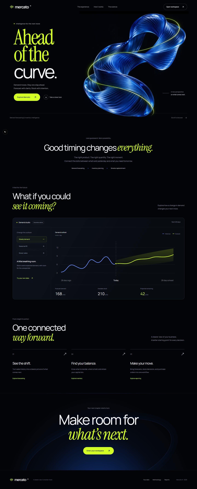
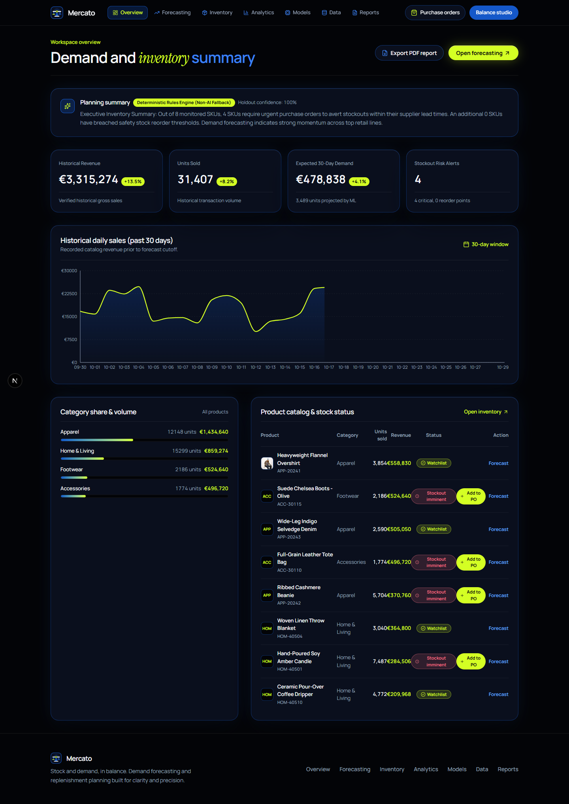
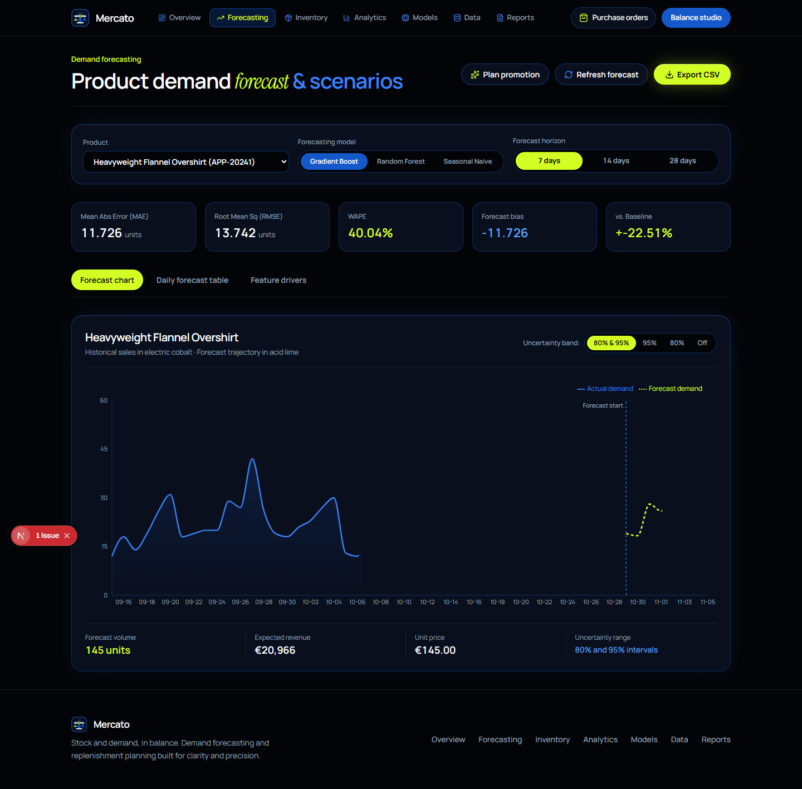
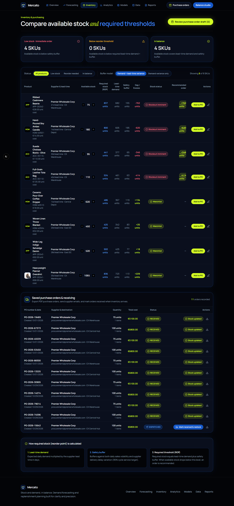
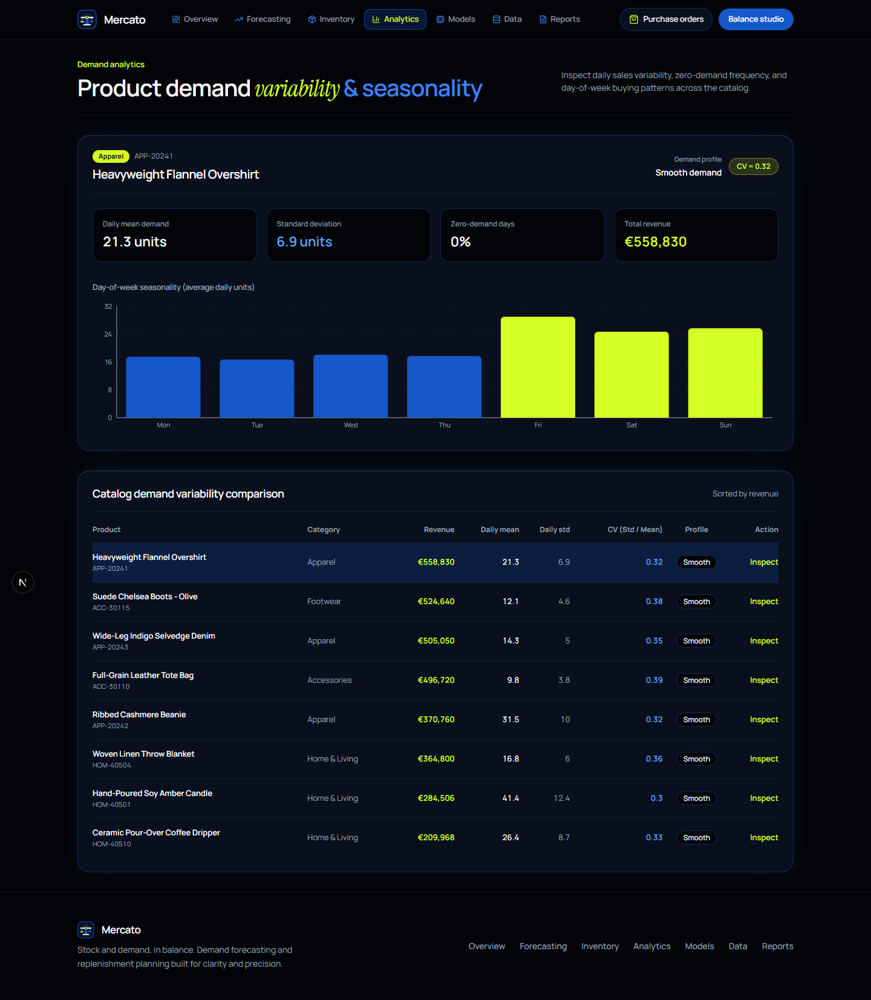
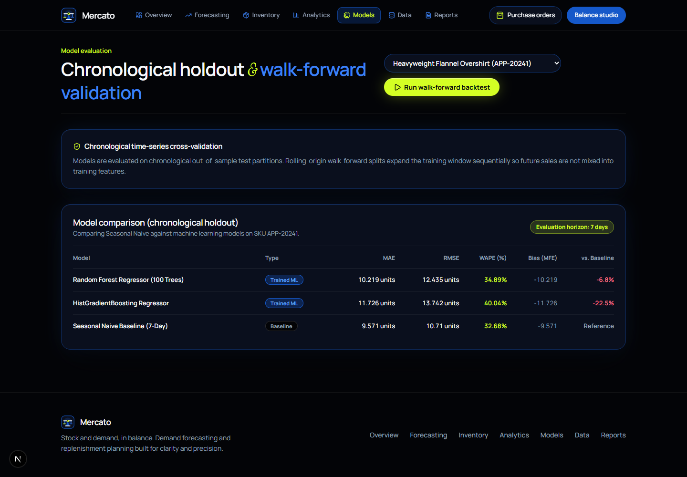
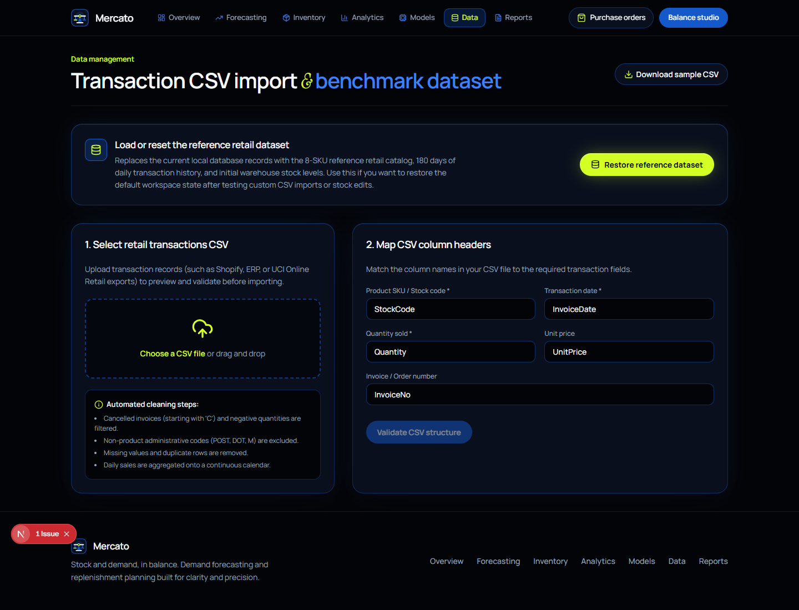
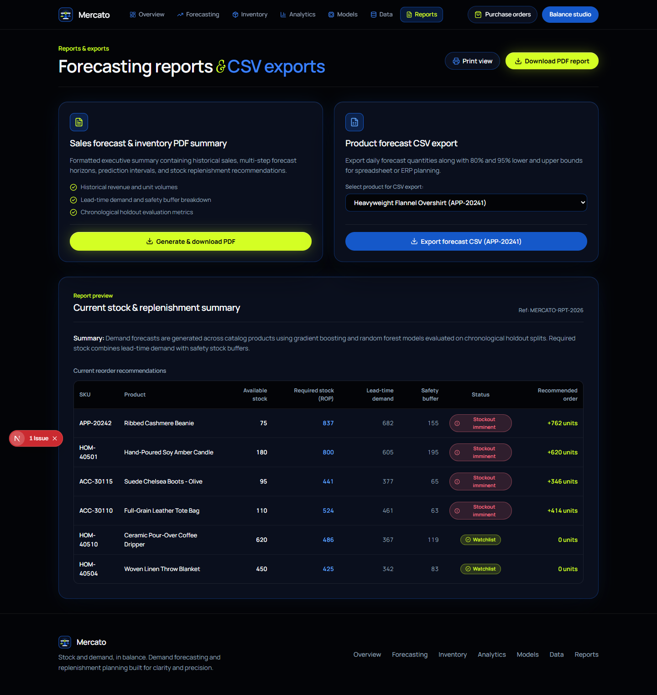

# Mercato AI — Ahead of the curve

Retail demand forecasting and inventory intelligence. Forecast with clarity. Stock with intention.

Mercato connects sales history, model evaluation, inventory planning, and purchase orders in a single workspace. Built as a computer science senior design project with a Next.js frontend and a FastAPI forecasting backend.



## Visual identity

The new landing experience pairs midnight black (`#030407`), electric cobalt (`#1558C9`), and acid lime (`#D4FF24`) with Manrope and Instrument Serif typography. Original cobalt ribbon artwork expresses a demand curve; a lime trajectory connects the visual to forecasting. The favicon uses a compact lime signal mark matching the landing wordmark.

The responsive layout includes visible keyboard focus, reduced-motion support, and an optimized WebP hero asset. The landing demo is explicitly illustrative; workspace screens use backend data. Screenshots below show the current local dataset, not promised performance or fixed business results.

## Get started

From the repository root:

```powershell
pnpm dev
```

On Windows, you can also run `start.bat` or `./start.ps1`. The launcher starts the frontend and backend, checks available ports, and proxies `/api/v1` requests to FastAPI. Use the local address printed by the launcher; it may select a port other than 3000. Stop the stack with Ctrl+C.

## Page-by-page tour

### Landing · `/`

An editorial introduction built around “Ahead of the curve,” with custom sculptural artwork, direct workspace navigation, and an interactive demand studio. Switch between steady demand, seasonal lift, and slower sales to see illustrative forecast curves and projected stock gaps change. These scenarios do not place orders or modify inventory.


### Workspace overview · `/overview`

A portfolio summary of historical revenue, units sold, forecast demand, and stockout alerts. Includes a recent sales chart, category share and volume, and a product catalog with forecast and purchase-order shortcuts. The planning summary identifies its AI or deterministic fallback mode.



### Demand forecasting · `/forecasting`

Select a product, forecasting model, and 7-, 14-, or 28-day horizon. Compare historical sales with projected demand, toggle 80% and 95% uncertainty bands, inspect daily forecast values and feature drivers, plan promotional scenarios, and export CSV data. MAE, RMSE, WAPE, bias, and baseline comparisons expose model quality rather than assuming every model beats the baseline.



### Inventory & purchasing · `/inventory`

Compare available inventory with lead-time demand, safety buffers, and reorder thresholds. Filter stock status, compare demand-only and dual-variance buffer models, review recommended order quantities, and build purchase-order drafts. Existing order workflows support dispatch, receipt, and PDF downloads. A draft order is distinct from stock received into inventory.



### Demand analytics · `/analytics`

Inspect product-level demand variability, average daily sales, standard deviation, coefficient of variation, zero-demand frequency, and revenue. Day-of-week charts reveal seasonal buying patterns; the catalog comparison lets you move between products and inspect their profiles.



### Model evaluation · `/models`

Compare Seasonal Naive, Random Forest, and Histogram Gradient Boosting on chronological holdout data. Review MAE, RMSE, WAPE, forecast bias, and performance relative to the baseline for each SKU. Run a walk-forward backtest to evaluate sequential training and test windows. Results depend on the dataset, product, and evaluation period.



### Data workspace · `/data`

Download a sample CSV, preview an uploaded dataset, inspect validation feedback, and import sales records. The backend supports column aliases and date normalization. Restoring the reference dataset replaces current local records with the eight-product catalog, 180 days of transactions, and initial stock levels. This explicit reset is separate from the landing demonstration.



### Reports & exports · `/reports`

Download executive PDF reports and product forecast CSVs. Select the relevant product and review the available inventory information before exporting. Reporting connects the analytical workspace to documents that can be shared outside the application.



## Technology

| Layer | Tools |
| --- | --- |
| Frontend | Next.js App Router, React, TypeScript, Tailwind CSS |
| Charts and interaction | Recharts, Framer Motion, custom SVG, Lucide |
| Backend | FastAPI, Python |
| Forecasting | scikit-learn, NumPy, pandas |
| Storage | SQLite, SQLAlchemy |
| Documents | ReportLab PDF generation, CSV exports |
| Planning summaries | Google GenAI integration with deterministic fallback |

## Validation

```powershell
pnpm typecheck
pnpm lint
pnpm test
pnpm build
pnpm test:backend
```

`pnpm test:all` runs the frontend and backend suites. Browser verification should also cover responsive layouts, forecast controls, and the purchase-order workflow. Screenshots document appearance; they are not proof that every backend operation has been tested.

## Repository guide

- `frontend/app/`: landing page and seven workspace routes.
- `frontend/components/`: charts, navigation, landing interactions, and purchasing UI.
- `frontend/lib/`: API client, design tokens, and purchase-order state.
- `frontend/public/images/`: hero artwork and image assets.
- `backend/app/`: APIs, forecasting, inventory calculations, and persistence.
- `backend/tests/`: backend tests.
- `scripts/`: local startup orchestration.
- `docs/images/`: current page screenshots and earlier visual references.

## Further documentation

- [Architecture](docs/ARCHITECTURE.md)
- [Functional requirements](docs/FUNCTIONAL_REQUIREMENTS.md)
- [Non-functional requirements](docs/NON_FUNCTIONAL_REQUIREMENTS.md)
- [Model evaluation report](docs/ML_EVALUATION_REPORT.md)
- [Testing guide](docs/TESTING_GUIDE.md)
- [Demonstration guide](docs/DEMONSTRATION_GUIDE.md)
- [Landing design and artwork provenance](docs/LANDING_REDESIGN.md)

Older design and evaluation documents may describe earlier iterations. The page tour and screenshots above document the current interface.
