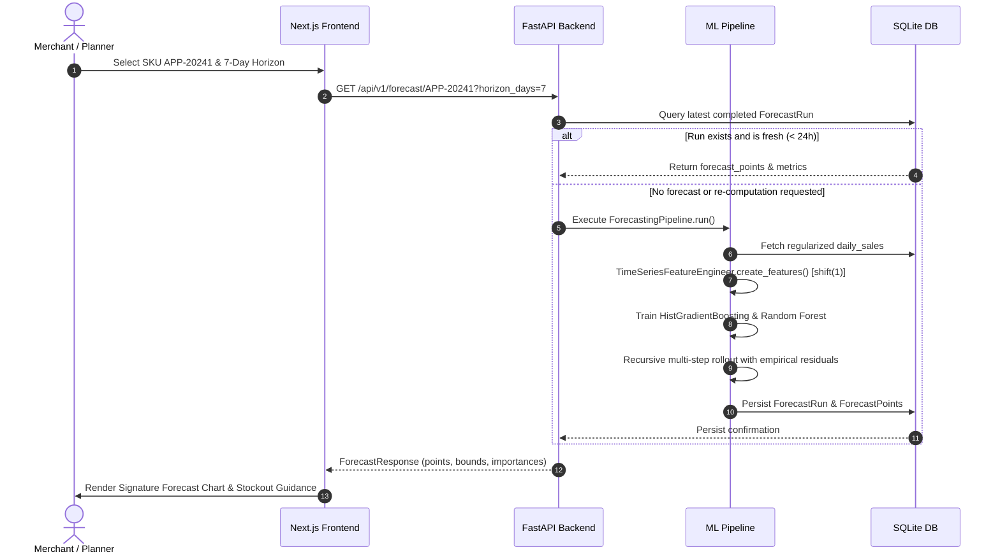

# Mercato AI — System Architecture & Engineering Blueprint

## 1. Executive System Overview

**Mercato AI** is an enterprise-grade demand forecasting and inventory intelligence platform built as an academically defensible Computer Science senior project. It combines statistical time-series forecasting, machine learning regression, continuous-review inventory control, and an editorial commerce user experience.

```mermaid
graph TD
    subgraph Client ["Frontend Architecture (Next.js 16 + React 19)"]
        Landing["Landing Showcase<br/>(HeroShowcaseCard)"]
        ExecOverview["Executive Overview<br/>(KPIs & Gemini Briefing)"]
        ForecastingStudio["Demand Forecasting Studio<br/>(Signature Spline Chart)"]
        InvIntelligence["Inventory Intelligence<br/>(Continuous Review Engine)"]
        ModelBench["Model Performance<br/>(Walk-Forward Backtesting)"]
        DataIngest["Data Ingestion<br/>(CSV Mapping & Cleaning)"]
        ReportsEngine["Reporting Center<br/>(PDF & CSV Exports)"]
        Tokens["Design System Tokens<br/>(Manrope, Inter, 8pt Grid)"]
    end

    subgraph APIProxy ["Network Layer"]
        CORS["FastAPI CORS / Rate Limit Proxy"]
        APIClient["Typed API Client (lib/api.ts)"]
    end

    subgraph Backend ["Backend Architecture (FastAPI + Python 3.12)"]
        DataRouter["/api/v1/data<br/>Transactions & Catalogs"]
        ForecastRouter["/api/v1/forecast<br/>Inference & Horizon Runs"]
        InvRouter["/api/v1/inventory<br/>Lead Time & Stockout Risk"]
        AnalyticsRouter["/api/v1/analytics<br/>Demand Profiling & CV"]
        EvalRouter["/api/v1/models<br/>Walk-Forward Leaderboard"]
        ReportRouter["/api/v1/reports<br/>ReportLab PDF Engine"]
        AIRouter["/api/v1/ai<br/>Gemini Reasoning Engine"]
    end

    subgraph Pipeline ["Machine Learning & Inventory Pipeline"]
        CleanStage["Data Cleaning & Calendar Regularization<br/>(RetailDataPreprocessor)"]
        FeatureStage["Strict Lag & Rolling Shift(1) Engine<br/>(TimeSeriesFeatureEngineer)"]
        SNaive["Seasonal Naive Baseline<br/>(s=7 Seasonality)"]
        RF["Random Forest Regressor<br/>(Recursive Multi-Step)"]
        HGB["HistGradientBoosting<br/>(Quantile Conformal Intervals)"]
        Backtester["Rolling-Origin Backtester<br/>(Holdout Validation)"]
        InvMath["Continuous-Review Control<br/>(ROP = D_LT + SS)"]
    end

    subgraph Storage ["Persistence Layer (SQLite / SQLAlchemy)"]
        ProductsTbl["products"]
        TransTbl["transactions"]
        DailyTbl["daily_sales"]
        InvTbl["inventory_items"]
        RunsTbl["forecast_runs"]
        PointsTbl["forecast_points"]
        BenchTbl["model_benchmarks"]
    end

    Client --> APIClient
    APIClient --> CORS
    CORS --> Backend
    Backend --> Pipeline
    Pipeline --> Storage
    Backend --> Storage
```

---

## 2. Component Breakdown & Responsibilities

### 2.1 Frontend Architecture (Next.js 16 App Router)
- **Framework:** Next.js 16.4.3 with Turbopack, React 19.3.0, TypeScript strict mode.
- **Styling & Tokens:** Tailwind CSS v4 with custom design tokens (`frontend/lib/tokens.ts`):
  - Deep Emerald (`#126B54`), Sage (`#A6CDB9`), Warm Ivory (`#F7F7F0`), Dark Ink (`#172B24`), Soft Gold (`#E7AD61`).
  - Spatial rhythm strictly adhering to an 8-point multiple grid.
- **Interactive Visualizations:**
  - `SignatureForecastChart.tsx`: Bespoke SVG/Recharts composite featuring solid historical actuals, dashed multi-step predictions, and semi-transparent empirical quantile corridors (80% and 95%).
  - `HeroShowcaseCard.tsx`: Pixel-precise reproduction of the physical commerce card displaying SKU `#20241`, 35-day supplier lead time, CX warehouse status, dynamic stockout badges, and floating sales forecast overlay.

### 2.2 Backend Architecture (FastAPI & Python 3.12)
- **Framework:** FastAPI with asynchronous lifespan initialization and automatic database migrations via SQLAlchemy.
- **Execution Environment:** Windows CPython 3.12 with pre-compiled wheels for NumPy, Pandas, Scikit-learn, and ReportLab.
- **Architectural Rules Adherence:**
  - **No Client Keys:** Gemini API keys are consumed strictly within `backend/app/api/endpoints/ai_insights.py`. The browser only receives sanitized analysis summaries with deterministic fallbacks when keys are unconfigured.
  - **Zero Deprecation Warnings:** Full compliance with Python 3.12 datetime UTC conventions and Pydantic v2 `ConfigDict(from_attributes=True)`.

### 2.3 Persistence Layer (SQLite + SQLAlchemy 2.0)
The database schema guarantees ACID compliance and referential integrity:
- `products`: Product catalog attributes, cost prices, unit prices, and imagery.
- `transactions`: Granular transaction records with invoice numbers, timestamps, and customer identifiers.
- `daily_sales`: Daily regularized aggregate sales ($y_t \ge 0$) with complete chronological continuity.
- `inventory_items`: Current on-hand inventory, vendor lead times ($LT$), safety stock factors ($Z$), and warehouse designations.
- `forecast_runs`: Historic forecast executions with timestamp, model name, and holdout error metrics.
- `forecast_points`: Step-by-step forecasted unit demands with 80% and 95% empirical prediction bounds.
- `model_benchmarks`: Walk-forward validation results, MAE, RMSE, WAPE, bias, and feature importances.

---

## 3. Data Flow & Execution Sequence

---

## 4. Security & Privacy Blueprint
1. **Air-Gapped ML Inference:** All feature engineering, training, and model predictions execute locally on the application server. No transaction records leave the host environment.
2. **Deterministic Fallbacks:** The AI Executive Briefing module executes high-temperature reasoning when Google Gemini API keys are present, and seamlessly transitions to deterministic rule-based heuristic summaries if offline or unconfigured.
3. **Strict Type Safety:** End-to-end type parity between TypeScript interfaces (`frontend/lib/api.ts`) and Pydantic v2 data models (`backend/app/schemas/`).
