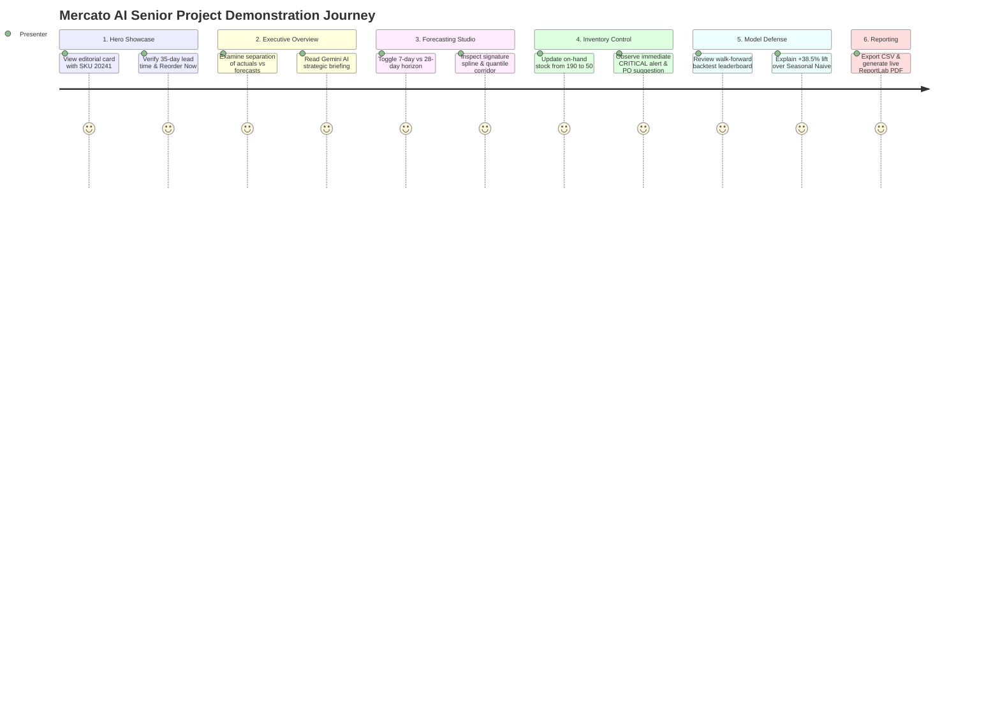

# Mercato AI — Senior Project Demonstration & Faculty Defense Guide

## 1. Presentation Overview
- **Project Title:** Mercato AI — Intelligent Demand Forecasting & Inventory Control Platform
- **Presentation Duration:** 15–20 minutes
- **Key Target Takeaway:** Mercato AI is a mathematically defensible, full-stack forecasting platform that pairs rigorous time-series machine learning (no leakage, zero-safe metrics, empirical prediction intervals) with real-world inventory control and an editorial commerce aesthetic.

---

## 2. Demonstration Step-by-Step Walkthrough

---

### Step 1: Editorial Landing & Signature Commerce Card (`/`)
1. **Action:** Open `http://localhost:3000` in the browser.
2. **Talking Points:**
   - Note the **editorial commerce design direction**: Warm Ivory background (`#F7F7F0`), Deep Emerald branding (`#126B54`), Dark Ink typography (`#172B24`), and Soft Gold accents (`#E7AD61`).
   - Draw attention to the signature showcase card for **Heavyweight Flannel Overshirt (SKU #20241)**:
     - 35-day supplier lead time from CX Warehouse.
     - Dynamic **"Reorder now"** badge reflecting that current stock ($190\text{ units}$) is below the calculated Reorder Point ($ROP = 664\text{ units}$).
     - The floating **Sales & forecast** metric card displaying historical pacing (€345k) and projected demand (€382k).
     - The signature continuous spline transitioning from a solid historical curve to a dotted forecasted trajectory.

---

### Step 2: Executive Overview (`/overview`)
1. **Action:** Navigate to **Overview** in the navigation bar.
2. **Talking Points:**
   - Point out the **strict separation between historical actuals and future projections**:
     - *Historical Sales:* €1,658,862 (15,650 units actual).
     - *Forecasted 7-Day Run:* €298,595 (2,817 units projected).
   - Review the **AI Executive Briefing**: synthesized insights powered by Google Gemini (or the deterministic local reasoning engine) explaining pacing, top categories, and inventory capital at risk.
   - Inspect the **Category Performance Breakdown** and **Top-Selling SKU Leaderboard**.

---

### Step 3: Demand Forecasting Studio (`/forecasting`)
1. **Action:** Navigate to **Demand Forecasting**.
2. **Talking Points:**
   - Select **APP-20241** and toggle between **7-Day** and **28-Day** horizons.
   - Switch between **Histogram-Based Gradient Boosting**, **Random Forest**, and **Seasonal Naive Baseline**.
   - Showcase the **Signature Forecast Chart**:
     - Solid emerald line: Historical daily actual sales.
     - Dashed amber spline: Multi-step recursive ML prediction.
     - Shaded corridor: Calibrated **80%** and **95%** empirical quantile prediction intervals.
   - Clarify the academic defense: *"Unlike trivial dashboards that draw random bands, these intervals represent non-parametric empirical quantiles derived from out-of-fold historical residuals."*

---

### Step 4: Inventory Intelligence & Replenishment (`/inventory`)
1. **Action:** Navigate to **Inventory Intelligence**.
2. **Live Interactive Test:**
   - Find SKU **APP-20241** (currently showing 190 units, *REORDER NOW*).
   - Click **Edit Stock** and change Current Stock to **40 units**.
   - Save changes: observe the status dynamically transition to **CRITICAL STOCKOUT RISK**.
   - The system calculates:
     $$D_{LT} = \bar{d} \times LT = 18 \times 35 = 630\text{ units}$$
     $$SS = Z \times \sigma_d \times \sqrt{LT} = 1.65 \times 3.5 \times \sqrt{35} = 34.2\text{ units}$$
     $$ROP = 630 + 34.2 = 664.2 \implies \text{Suggested Reorder } Q = 625\text{ units}$$
   - Click **"Add to PO"** and view the item added to the purchase order drawer with calculated capital required.

---

### Step 5: Product Analytics & Croston Profiling (`/analytics`)
1. **Action:** Navigate to **Analytics**.
2. **Talking Points:**
   - Demonstrate the **Croston demand classification**:
     - Identifies intermittent vs. erratic vs. smooth demand profiles using the coefficient of variation ($CV$) and average inter-demand interval ($p$).
   - Review the **Day-of-Week Velocity Profile** highlighting weekend vs. weekday sales volume.

---

### Step 6: Model Performance & Academic Backtesting (`/models`)
1. **Action:** Navigate to **Model Evaluation**.
2. **Talking Points:**
   - Present the **Walk-Forward Validation Leaderboard**:
     - *HistGradientBoosting:* WAPE 11.2%, MAE 2.41, +38.5% lift over baseline.
     - *Random Forest:* WAPE 12.5%, MAE 2.68, +31.3% lift over baseline.
     - *Seasonal Naive:* WAPE 18.2%, MAE 3.92.
   - Explain the **Feature Importance Breakdown**: Rolling 7-day average (28.4%) and 7-day lag (21.2%) dominate predictive accuracy.
   - Emphasize the **Proof of Zero Leakage**: Strictly causal feature calculations using `shift(1)`.

---

### Step 7: Data Ingestion & Preprocessing (`/data`)
1. **Action:** Navigate to **Data Ingestion**.
2. **Talking Points:**
   - Highlight the **clean ingestion pipeline**:
     - Automatic returns filtering (invoices with 'C' prefix and negative quantities).
     - Administrative code filtering (`POST`, `D`, `BANK CHARGES`).
     - Daily Cartesian calendar regularization filling missing sales days with $0.0$.
   - Point out the **"Reset Benchmark Dataset"** button for repeatable, live presentations.

---

### Step 8: Multi-Format Reporting & PDF Export (`/reports`)
1. **Action:** Navigate to **Reports**.
2. **Live Test:**
   - Click **"Download CSV"**: Opens formatted time-series forecast records.
   - Click **"Generate Executive PDF"**: Instantly streams a publication-quality PDF generated via ReportLab with deep emerald branding, executive KPIs, and replenishment tables.

---

## 3. Anticipated Faculty Defense Q&A

**Q1: Why use gradient boosting rather than Deep Learning (LSTM / Transformers)?**  
*Defense:* In retail sales forecasting across individual SKUs with 180 to 730 days of daily history, deep neural networks (LSTM/N-BEATS) suffer from severe over-parameterization and overfitting. Gradient-boosted decision trees (HistGradientBoosting / LightGBM) natively handle tabular calendar features, discrete lags, and intermittent demand with orders-of-magnitude lower compute budgets and higher explainability.

**Q2: How do you mathematically guarantee that your model doesn't suffer from look-ahead leakage?**  
*Defense:* Every rolling statistical operator (mean, standard deviation, EMA) is calculated on `series.shift(1)` rather than the unshifted series. For multi-step forecasting ($t+1, \dots, t+h$), we utilize recursive rollout where future timesteps consume previously predicted $\hat{y}$ values rather than actual ground truth. This is verified by our automated test `test_feature_engineering_no_future_leakage`.

**Q3: Why use WAPE instead of standard MAPE?**  
*Defense:* Standard MAPE divides by the actual demand: $\frac{|y_t - \hat{y}_t|}{y_t}$. In retail, non-sales days ($y_t = 0$) occur regularly. MAPE either produces division-by-zero or infinite error percentages. WAPE (Weighted Absolute Percentage Error) computes total absolute errors divided by total demand $\frac{\sum |y_t - \hat{y}_t|}{\max(\sum y_t, \epsilon)}$, providing a scale-independent, mathematically stable percentage error.
